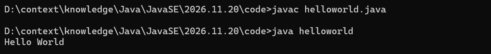
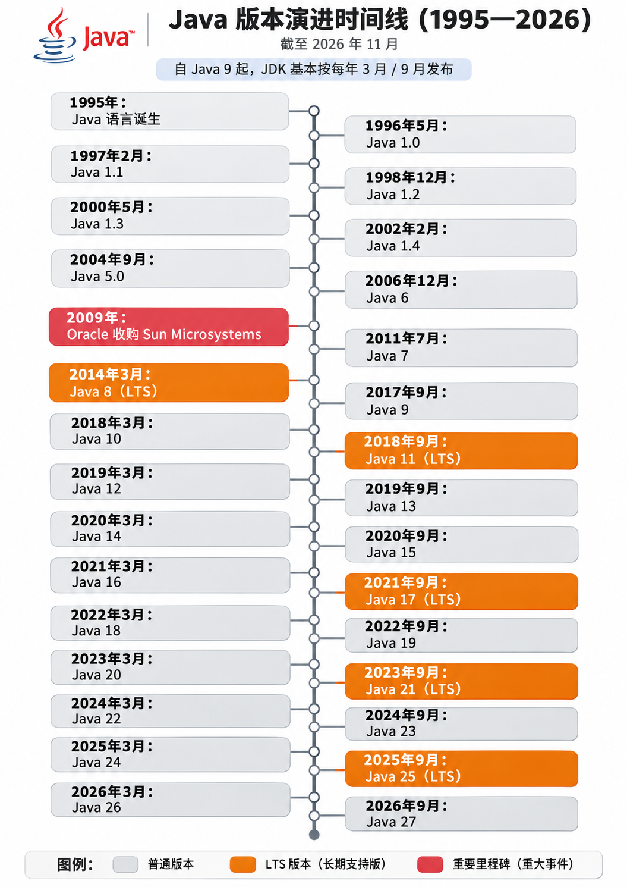
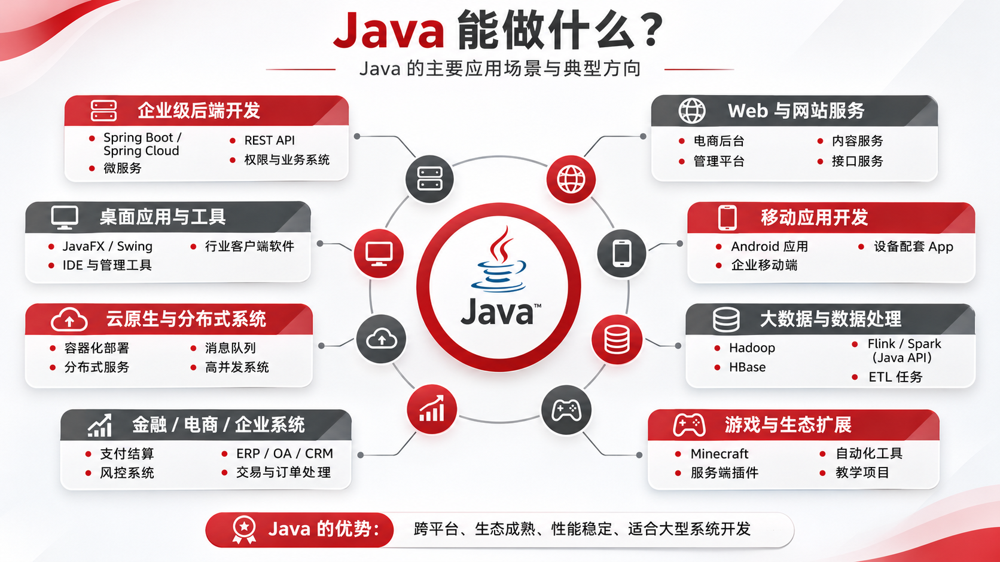
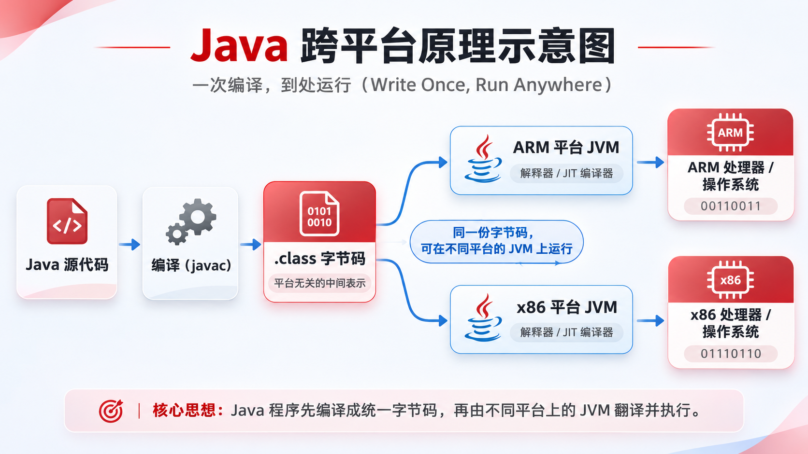
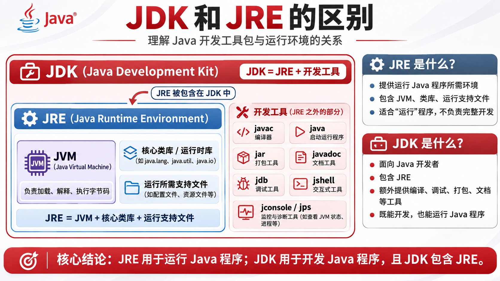

# 第一个代码——Hello World

首先创建文件 `helloworld.java`，后缀必须是 `.java`。

然后编写程序：

```java
public class helloworld {
	public static void main(String[] args) {
		System.out.println("Hello World");
	} 
}
```

然后在 **该目录** 下编译运行文件：

```
# 编译文件
javac helloworld.java
```

```
# 运行文件
java helloworld
```



就算是这么简单的代码，对于初学者也可能会出现非常多的问题。

而对于程序上的问题，我们一般叫做 `Bug`。

所以，程序员需要具备的一项能力就是 `识别、分析、解决 Bug` 能力。

**常见问题：**

1. 中英文符号问题：符号必须是英文的
2. 大小写问题：`System` 首字母必须是大写


# Java 的历史

Java 的历史可以看看这个博客：[Java 发展史：从橡树计划到数字世界的基石-云社区-华为云](https://bbs.huaweicloud.com/blogs/494407#1)

Java 版本的时间线：



需要了解到的就是，Java 从诞生之初就确立了一个核心设计哲学——`Write Once, Run Anywhere`（一次编写，导出运行）。这一理念的实现，依赖于其独特的 `字节码 + Java虚拟机(JVM)` 架构。所以，Java 天生就具备 **简单**、**健壮**、**安全**、**可移植** 等特性。


# JavaSE、JavaEE、JavaME

| 平台        | 全称                                           | 定位与目标场景                                               | 与Java SE的关系                                              | 核心组成/技术举例                                            |
| :---------- | :--------------------------------------------- | :----------------------------------------------------------- | :----------------------------------------------------------- | :----------------------------------------------------------- |
| **Java SE** | Java Platform, **Standard Edition** (标准版)   | 通用平台，用于开发**桌面应用**和**服务器端的基础应用**。它定义了Java语言的核心功能。 | **基础与核心**。它提供了Java最根本的API和虚拟机（JVM）。     | 基础类型、集合、IO、网络、GUI（Swing/JavaFX）、数据库访问（JDBC）等核心类库。 |
| **Java EE** | Java Platform, **Enterprise Edition** (企业版) | 企业级应用平台，专用于开发和运行**大规模、多层、可伸缩、可靠且安全的网络应用**（如大型网站、企业后台系统）。 | **构建于Java SE之上**。它包含了Java SE的全部功能，并额外增加了用于简化企业开发的组件和服务。 | Servlet, JSP, EJB (Enterprise JavaBeans), JPA (Java Persistence API), Web Services等。 |
| **Java ME** | Java Platform, **Micro Edition** (微型版)      | 为**资源受限的小型设备**提供运行环境，如早期的功能手机、PDA、机顶盒、传感器以及物联网(IoT)设备等。 | **Java SE API的子集**。它舍弃了SE中对于小设备不必要的部分，并增加了适合微型设备的专用类库。 | 一个“小内存占用”的虚拟机，以及针对小型设备的特定API。Java ME应用常作为Java EE服务的客户端。 |

# Java 能做什么？




# Java 的特性

1. 跨平台
2. 面向对象
3. 安全性
4. 多线程


# Java 的跨平台原理

一张图就看的明白：



编译阶段会统一生成 `.class` 的字节码文件，这个文件与平台无关。

运行阶段才会根据平台的不同在对应的 `JVM` 虚拟机上运行。

# JDK 与 JRE 的区别




